# Ocupação Inteligente — Indústria 4.0

Pipeline de Ciência de Dados e Machine Learning para identificar a ocupação de ambientes a partir de sensores ambientais IoT, aplicado à automação predial e à eficiência energética.

> **Status:** as sete fases analíticas (EDA, Data Prep, Feature Engineering, divisão treino/teste, escalonamento, hiperparâmetros e avaliação final) estão implementadas no script `ocupacao_inteligente.py`, incluindo uma revisão metodológica da precisão decimal dos atributos. As Fases 1 a 6 foram integradas à `develop` pelos pull requests #1 a #10; a Fase 7 original e a revisão decimal são integradas pelo pull request da branch `feature/07-avaliacao-modelos`, em commits separados. O notebook único executado e o merge na `main` serão as etapas finais de entrega; até lá, a `main` contém apenas a estrutura inicial.

| Item | Informação |
|---|---|
| Autor | Petras Ruben Carvalho |
| Curso | SCTEC Aperfeiçoar — Integração de IA com Dados (SENAI/SC) |
| Professor | Felipe Rodrigues Souza |
| Entrega | AVA, até 30/11/2026 às 22h |

## 1. Problema e objetivo

Um complexo industrial equipado com sensores ambientais precisa saber se salas técnicas e escritórios estão ocupados, para automatizar o desligamento de iluminação e climatização (HVAC). O projeto treina e compara dois classificadores supervisionados — **KNN (K-Nearest Neighbors)** e **Árvore de Decisão** — para prever a variável binária `Occupancy` (0 = desocupado, 1 = ocupado), usando a acurácia como métrica principal e métricas por classe como complemento.

O trabalho é experimental: não inclui integração com equipamentos reais nem estimativa de economia de energia.

## 2. Base de dados

**Occupancy Detection** — Luis Candanedo (2016), UCI Machine Learning Repository. DOI [10.24432/C5X01N](https://doi.org/10.24432/C5X01N). Licença [CC BY 4.0](https://creativecommons.org/licenses/by/4.0/). Página oficial: [archive.ics.uci.edu/dataset/357](https://archive.ics.uci.edu/dataset/357/occupancy-detection).

| Coluna | Descrição | Unidade |
|---|---|---|
| `date` | Data e hora da observação | `AAAA-MM-DD hh:mm:ss` |
| `Temperature` | Temperatura do ambiente | °C |
| `Humidity` | Umidade relativa do ar | % |
| `Light` | Luminosidade | lux |
| `CO2` | Concentração de dióxido de carbono | ppm |
| `HumidityRatio` | Razão de umidade, derivada da temperatura e da umidade relativa | kg de vapor / kg de ar |
| `Occupancy` | Variável alvo | 0 = desocupado, 1 = ocupado |

### Composição da base

| Arquivo | Registros | Período (2015) | Ocupados | Uso |
|---|---:|---|---:|---|
| `datatest.txt` | 2.665 | 02/02 14:19 a 04/02 10:43 | 36,47% | Consolidado |
| `datatraining.txt` | 8.143 | 04/02 17:51 a 10/02 09:33 | 21,23% | Fora da consolidação; avaliação complementar na Fase 7 |
| `datatest2.txt` | 9.752 | 11/02 14:48 a 18/02 09:19 | 21,01% | Consolidado |
| **Base utilizada** | **12.417** | dois segmentos contínuos | **24,33%** | Fases 1 a 7 |

A consolidação dos dois arquivos `datatest` é uma escolha metodológica deste projeto, distinta do protocolo original de avaliação do conjunto de dados (a UCI descreve os arquivos apenas como conjuntos "for training and testing"). O exemplo do enunciado lê somente `datatest.txt`. O arquivo `datatraining.txt` é preservado sem alterações e foi usado apenas na avaliação complementar da Fase 7, sem nenhum ajuste de modelo. Atribuição, hashes SHA-256 e rastreabilidade das bases derivadas: [dados/README.md](dados/README.md).

### Camadas de dados e precisão decimal

| Camada | Arquivo | Precisão dos atributos |
|---|---|---|
| Dados brutos | `dados/brutos/` (ZIP da UCI e três `.txt`) | Original, sem alterações |
| Dados consolidados | `dados/consolidados/occupancy.csv` | Original (referência rastreável das fontes) |
| Dados tratados | `dados/tratados/occupancy_tratado.csv` | Padronizada pela regra decimal (Fase 2) |
| Feature Engineering | `dados/features/occupancy_features.csv` | Atributos tratados; `CO2_Light_Ratio` com precisão integral |
| Modelagem | Conjuntos em memória (Fases 4 a 7) | Atributos tratados |

| Atributo | Casas decimais | Exemplo real (registro 0): fonte → tratado |
|---|---:|---|
| `Temperature` | 1 | 23.7 → 23.7 |
| `Humidity` | 2 | 26.272 → 26.27 |
| `Light` | 1 | 585.2 → 585.2 |
| `CO2` | 1 | 749.2 → 749.2 |
| `HumidityRatio` | 5 | 0.00476416302416414 → 0.00476 |

A regra foi definida pelo estudante após inspecionar os CSVs, nos quais os atributos apareciam com quantidades muito diferentes de casas decimais (por exemplo, `Light` = 572.666666666667). Ela não é uma exigência do enunciado. `Occupancy` (inteiro) e `date` não são alterados. Detalhes na seção 7, Fase 2, e na seção 8.

## 3. Tecnologias

| Tecnologia | Versão testada | Uso |
|---|---|---|
| Python | 3.14.4 | Linguagem |
| pandas | 3.0.2 | Manipulação de dados |
| NumPy | 2.4.4 | Operações numéricas |
| Matplotlib | 3.10.9 | Gráficos |
| Seaborn | 0.13.2 | Gráficos estatísticos |
| scikit-learn | 1.8.0 | Modelagem, Pipeline, validação cruzada e métricas |
| SciPy | 1.18.1 | Correlação de Spearman (pandas) e teste exato de McNemar (`binomtest`) |
| ipykernel | 7.2.0 | Execução do notebook |

Ferramentas: VS Code com células `# %%`, Jupyter, Git e GitHub.

As versões acima estão fixadas no [`requirements.txt`](requirements.txt). O projeto foi testado apenas em **Python 3.14.4 no Windows**. Os metadados das dependências selecionadas exigem Python 3.12 ou superior (`scipy==1.18.1`); não há garantia de compatibilidade com versões não testadas.

O `requirements.txt` contém somente as dependências de execução do projeto. As ferramentas usadas para converter o script em notebook (`jupytext` e `nbconvert`) são instaladas à parte, apenas no momento da exportação.

## 4. Estrutura do repositório

```text
ocupacao_inteligente_industria_4_0/
├── dados/
│   ├── brutos/            # pacote original da UCI e os três arquivos .txt (sem alterações)
│   ├── consolidados/      # occupancy.csv — 12.417 × 7, precisão original
│   ├── tratados/          # occupancy_tratado.csv — 12.417 × 7, precisão padronizada (Fase 2)
│   ├── features/          # occupancy_features.csv — 12.417 × 8 (Fase 3)
│   └── README.md          # origem, licença, hashes e rastreabilidade
├── resultados/
│   ├── graficos/          # 16 gráficos em 300 DPI (Fases 1 a 7 e revisão)
│   ├── modelagem/         # 10 CSVs de validação, métricas, previsões e auditoria da precisão
│   └── referencia_historica/  # resultados preservados da versão anterior à regra decimal
├── ocupacao_inteligente.py  # desenvolvimento em células # %% (fonte do notebook)
├── requirements.txt
├── README.md
├── .gitignore
└── .gitattributes
```

O notebook único de entrega (`ocupacao_inteligente.ipynb`) ainda não está no repositório: será gerado a partir do script e executado ao final.

## 5. Como executar

```powershell
git clone https://github.com/petrascarvalho/ocupacao_inteligente_industria_4_0.git
cd ocupacao_inteligente_industria_4_0
git switch develop
py -3.14 -m venv .venv
.\.venv\Scripts\python.exe -m pip install -r requirements.txt
```

No VS Code, selecione o interpretador `.venv` e execute as células do arquivo [`ocupacao_inteligente.py`](ocupacao_inteligente.py) em ordem. Também é possível executar o script inteiro pelo terminal, a partir da raiz do repositório:

```powershell
.\.venv\Scripts\python.exe ocupacao_inteligente.py
```

Na execução pelo terminal, cada gráfico abre em uma janela, e a execução continua depois que a janela é fechada.

Todos os caminhos são relativos à raiz do repositório. Se os arquivos de `dados/brutos/` não existirem, o BLOCO 04 baixa o pacote oficial da UCI e extrai os arquivos necessários. A comparação com a versão anterior lê apenas `resultados/referencia_historica/resultados_versao_precisao_integral.csv`, que faz parte do repositório; nenhuma unidade externa ou backup pessoal é necessário.

A versão atual foi executada duas vezes do início ao fim, a partir dos dados brutos, em cópias isoladas com as versões de bibliotecas acima: cerca de 33 segundos por execução, sem erros nem avisos, com os 30 arquivos derivados (3 bases, 16 gráficos, 10 CSVs e a referência histórica) idênticos byte a byte entre as execuções. A conversão para notebook (`jupytext` + `nbconvert`) também foi testada fora do repositório: 223 células executadas em sequência, sem erros, com 16 imagens e os mesmos arquivos reproduzidos.

## 6. Organização das fases

| Etapa | Conteúdo | Situação |
|---|---|---|
| Preparação e ETL (Blocos 00–09) | Ambiente, caminhos, download condicional, leitura, inventário dos arquivos originais, consolidação e validação | Concluída |
| Fase 1 — EDA (Blocos 10–17) | Estrutura, tipos, estatísticas, histogramas, classes, correlação, análise e dependência temporal (camada consolidada) | Concluída |
| Fase 2 — Data Prep (Blocos 18–28) | Padronização da precisão decimal, duplicidades, ausentes, imputação simulada, tipos, boxplots, IQR e auditoria do arredondamento | Concluída |
| Fase 3 — Feature Engineering (Blocos 29–36) | Criação e validação de `CO2_Light_Ratio` | Concluída |
| Fase 4 — Divisão dos dados (Blocos 37–47) | X e y; treino 80% e teste 20% com `stratify=y` e `random_state=42`; integridade e proximidade temporal | Concluída |
| Fase 5 — Escalonamento (Blocos 48–60) | `StandardScaler` ajustado só no treino, apenas para o KNN; validação e análise das distâncias | Concluída |
| Fase 6 — Hiperparâmetros (Blocos 61–79) | Pipeline do KNN, validação cruzada estratificada, seleção, acurácia de treino e teste, 5 × 6 atributos, validação temporal | Concluída |
| Fase 7 — Avaliação final (Blocos 80–102) | Baseline, matrizes de confusão, métricas por classe, análise de erros, `datatraining.txt`, veredito | Concluída |
| Revisão da precisão decimal (Blocos 103–108) | Comparação integral entre a versão com precisão original e a revisada | Concluída |

## 7. Resultados

Os resultados das Fases 2 a 7 referem-se aos dados com a precisão decimal padronizada.

### Fase 1 — Análise exploratória (base consolidada, precisão original)

- 12.417 registros, 7 colunas, nenhum valor ausente; `date` em texto, sensores em `float64`, `Occupancy` em `int64`.
- Classes: 9.396 desocupados (75,67%) e 3.021 ocupados (24,33%). A acurácia de um classificador que sempre prevê "desocupado" seria 75,67%.
- Correlação de Pearson com `Occupancy`: `Light` 0,9197; `Temperature` 0,5764; `CO2` 0,3710; `HumidityRatio` 0,2420; `Humidity` −0,0427. Entre preditores: `Humidity` × `HumidityRatio` 0,8919 e `Temperature` × `Light` 0,7248.
- `Light` tem mediana zero (61,30% das leituras são zero); `CO2` é assimétrica à direita.
- Dependência temporal: observações a cada 59–61 segundos, em dois segmentos contínuos (2.665 e 9.752 registros) separados por 7 dias, 4 horas e 5 minutos. A autocorrelação de lag 1 dos sensores varia de 0,9952 a 0,9995 dentro dos segmentos, e a classe se mantém em 99,40% das 12.415 transições válidas.
- As estatísticas da EDA mudam de forma residual com a regra decimal (a correlação de `Light` com `Occupancy` continua 0,9197); a comparação está no BLOCO 25.4.


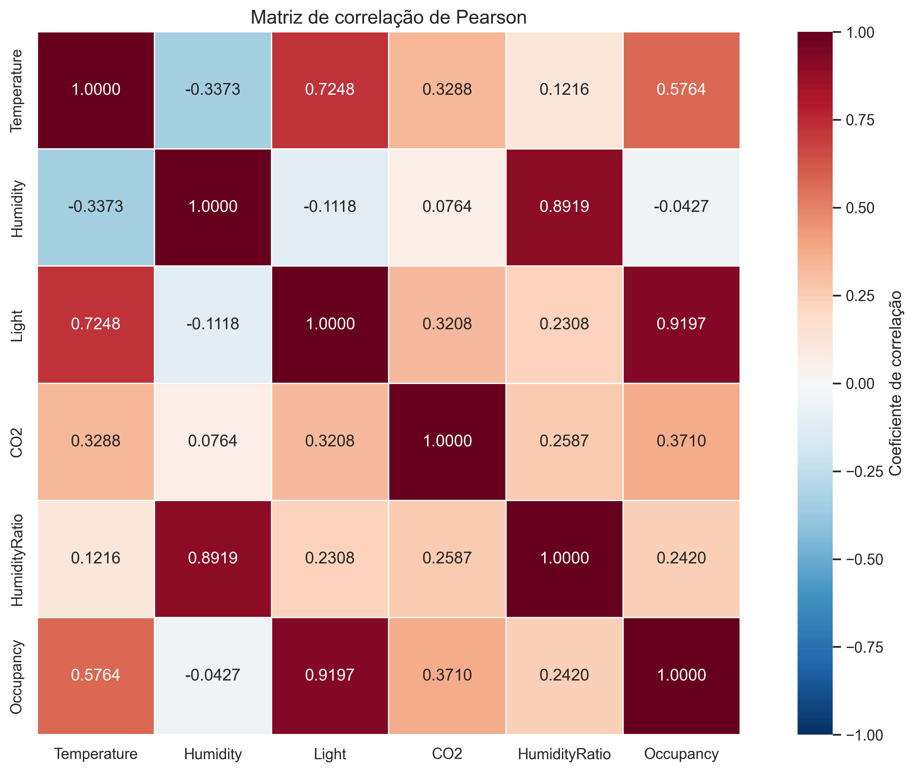

### Fase 2 — Limpeza, tratamento e padronização decimal

- **Precisão textual das fontes:** de 0 a 13 casas decimais em `Temperature` e `Humidity`, até 14 em `Light`, até 12 em `CO2` e de 13 a 17 em `HumidityRatio`. A resolução física dos sensores não está documentada na página da UCI; a regra decimal é uma convenção de consistência, legibilidade e governança, e não a precisão real dos equipamentos.
- **Auditoria do arredondamento** (`df_tratado.round(casas_decimais)`, somente nas cinco colunas):

| Atributo | Casas | Valores modificados | Diferença absoluta média | Maior diferença | Valores distintos |
|---|---:|---:|---:|---:|---:|
| `Temperature` | 1 | 7.045 (56,74%) | 0,0118 °C | 0,05 °C | 444 → 50 |
| `Humidity` | 2 | 3.708 (29,86%) | 0,00116 % | 0,005 % | 1.815 → 1.134 |
| `Light` | 1 | 855 (6,89%) | 0,00286 lux | 0,05 lux | 1.439 → 1.424 |
| `CO2` | 1 | 3.376 (27,19%) | 0,0111 ppm | 0,05 ppm | 4.262 → 4.114 |
| `HumidityRatio` | 5 | 12.417 (100%) | 2,49 × 10⁻⁶ | 5,0 × 10⁻⁶ | 6.220 → 250 |

- Todas as alterações ficaram dentro de meia unidade da última casa; a regra é idempotente; 12.417 registros, índices, ordem, timestamps, `Occupancy` e tipos `float64` foram preservados; nenhum ausente, infinito ou zero novo foi criado. Os empates de arredondamento seguem o `numpy.round` (meio-par sobre o valor binário armazenado); em 89 empates textuais de `Humidity`, o resultado seguiu o valor binário.
- **Cardinalidade:** redução de 95,98% em `HumidityRatio`, 88,74% em `Temperature`, 37,52% em `Humidity`, 3,47% em `CO2` e 1,04% em `Light`. Menos valores distintos não significam melhor qualidade preditiva, e a resolução física dos sensores não foi confirmada.
- **Impacto na qualidade dos dados:** médias, desvios padrão e correlações mudaram de forma residual (maior alteração na matriz de Pearson: 9,8 × 10⁻⁴). O arredondamento fundiu 64 vetores de sensores originalmente distintos em 32, elevando as repetições de vetores de 571 para 603, e reduziu os potenciais outliers de `Temperature` de 461 para 447 (limite superior IQR de 23,6025 para 23,65 °C).
- 0 duplicatas integrais e 0 timestamps repetidos. 603 repetições apenas das medições dos sensores, em instantes diferentes (1.090 registros, 1.084 deles desocupados), sem conflito de classe — mantidas.
- 0 ausentes e 0 infinitos na base real. Imputação demonstrada em cópia isolada (semente 42): média para `Humidity` e mediana para `CO2`.
- Boxplots e IQR: 447 potenciais outliers em `Temperature`, 7 em `Light` e 992 em `CO2`, todos plausíveis e mantidos.
- Base tratada exportada com a quantidade fixa de casas de cada atributo (por exemplo, `26.30` em `Humidity`), por uma cópia textual exclusiva para exportação; a recarga com `float_precision="round_trip"` é idêntica à base em memória (`check_exact=True`).

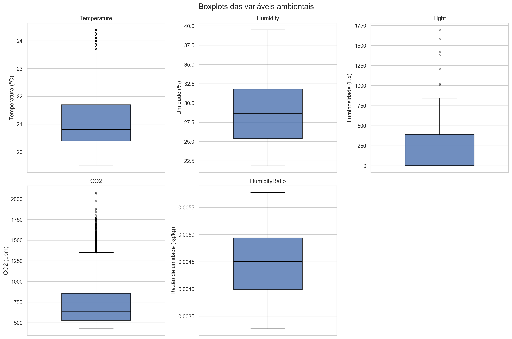
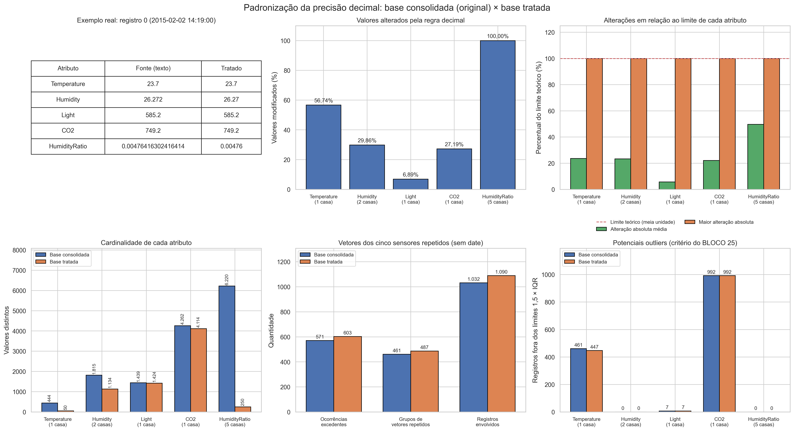

### Fase 3 — Feature Engineering

- **`CO2_Light_Ratio = CO2 / (Light + 1)`**, calculada registro a registro com os atributos tratados, sem usar `Occupancy`, e mantida com precisão integral do `float64`.
- `float64`, 0 ausentes, 0 infinitos, 6.928 valores distintos; média 426,13, mediana 503,0, mínimo 0,56 e máximo 2.076,5.
- Com `Light = 0` (7.612 registros), o índice é exatamente igual a `CO2`; com `Light > 0` (4.805 registros), fica entre 0,56 e 261,75.
- Correlação com as variáveis de origem: `CO2` — Pearson 0,2419 e Spearman 0,0686; `Light` — Pearson −0,6607 e Spearman −0,8633.


### Fase 4 — Divisão treino/teste

- `X` com seis atributos (`Temperature`, `Humidity`, `Light`, `CO2`, `HumidityRatio`, `CO2_Light_Ratio`); `y = Occupancy`; `date` fora de `X`.
- `train_test_split(test_size=0.2, stratify=y, random_state=42)`, antes de qualquer transformação de escala: 9.933 registros de treino (7.516 / 2.417) e 2.484 de teste (1.880 / 604). Os índices são idênticos aos da versão anterior à regra decimal (SHA-256 conferido).
- **96,10%** dos registros de teste têm um vizinho de treino a até 61 segundos: a acurácia de teste tende a ser otimista para outros períodos.

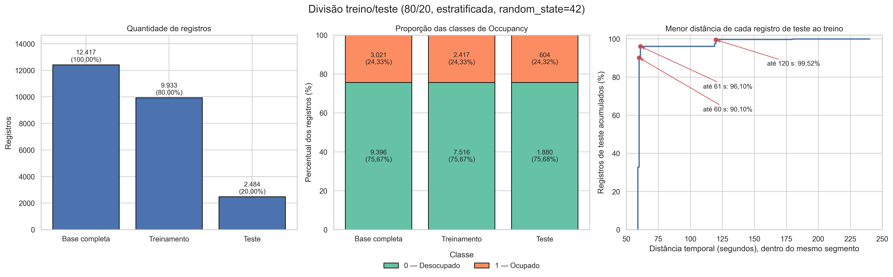

### Fase 5 — Escalonamento com StandardScaler

- `fit_transform` somente em `X_train`; `X_test` recebe apenas `transform`. A Árvore de Decisão usa os dados sem escala, pois suas divisões dependem apenas da ordem dos valores.

| Atributo | Média (`mean_`) | Desvio padrão (`scale_`) |
|---|---:|---:|
| Temperature | 21,0963 | 1,03733 |
| Humidity | 28,9189 | 4,12595 |
| Light | 137,866 | 219,168 |
| CO2 | 746,499 | 297,485 |
| HumidityRatio | 0,00446843 | 0,000595275 |
| CO2_Light_Ratio | 426,774 | 404,489 |

- As 18 quantidades aprendidas coincidem com o cálculo independente, e os 74.502 valores transformados são idênticos à fórmula `z = (x − μ) / σ`.
- Transformação inversa: 92,82% dos valores do treino e 92,91% dos do teste são reconstruídos com igualdade binária exata, e 100% ficam dentro da tolerância (erro absoluto máximo de 2,27 × 10⁻¹³, menos de 0,6 ulp da maior magnitude de cada atributo). As diferenças são de arredondamento de ponto flutuante, não erros relevantes.
- Em 1.000 pares de registros do treino, `CO2_Light_Ratio` e `CO2` respondiam por 83,03% do quadrado da distância antes da padronização; depois, cada atributo contribui entre 13,63% e 20,73%.

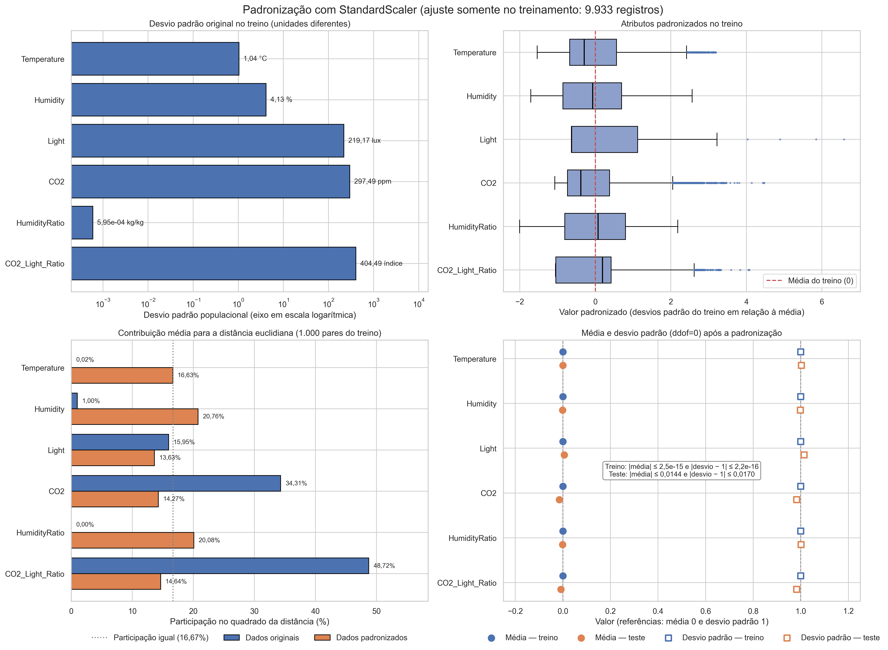

### Fase 6 — Hiperparâmetros e Pipeline

- KNN em `Pipeline(StandardScaler, KNeighborsClassifier)` com K ∈ {3, 5, 7, 9, 11}; Árvore com `max_depth` ∈ {3, 5, 10, None}. Seleção pela maior acurácia média em `StratifiedKFold(5, shuffle=True, random_state=42)` somente no treino, registrada antes de consultar o teste.
- **Selecionados: K = 3 e `max_depth` = 5.** K = 3 teve 99,1744% e K = 5, 99,1644% de acurácia média de validação (média não ponderada dos folds, critério pré-definido). Nos cinco folds, K = 3 acertou 9.851 de 9.933 registros e K = 5, 9.850: a diferença é de **um único registro** e não demonstra superioridade robusta.

| Configuração | Treino | Validação cruzada | Teste | Treino − teste |
|---|---:|---:|---:|---:|
| **K = 3** | 99,57% | **99,17%** | 99,56% | 0,01 p.p. |
| K = 5 | 99,47% | 99,16% | 99,56% | −0,09 p.p. |
| K = 7 | 99,33% | 99,13% | 99,07% | 0,25 p.p. |
| K = 9 | 99,21% | 99,11% | 99,03% | 0,18 p.p. |
| K = 11 | 99,15% | 99,08% | 98,91% | 0,24 p.p. |
| `max_depth` = 3 | 99,17% | 99,05% | 98,63% | 0,54 p.p. |
| **`max_depth` = 5** | 99,28% | **99,07%** | 99,03% | 0,24 p.p. |
| `max_depth` = 10 | 99,66% | 98,99% | 99,11% | 0,54 p.p. |
| `max_depth` = None | 100,00% | 98,96% | 99,24% | 0,76 p.p. |

- **Overfitting:** mais claro na Árvore sem limite (100% no treino) e com profundidade 10. O KNN com K = 3 teve a maior diferença entre treino e validação cruzada entre os KNN (0,37 p.p.), sem queda no teste.
- **Variável derivada:** sem ganho preditivo demonstrado (KNN idêntico com 5 e 6 atributos; Árvore entre −0,06 e +0,01 p.p.).
- **Validação temporal** (`TimeSeriesSplit(5, gap=60)` no treino): acurácia média de 94,62% (KNN) e 87,27% (Árvore). No fold 3 (fim de semana sem ocupação), 80,06% e 45,86%.

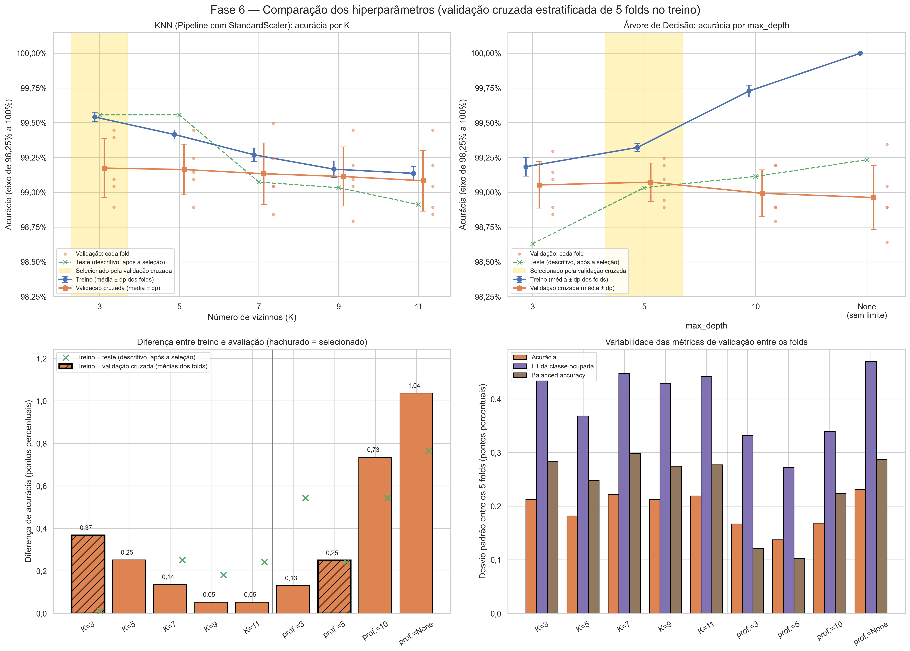
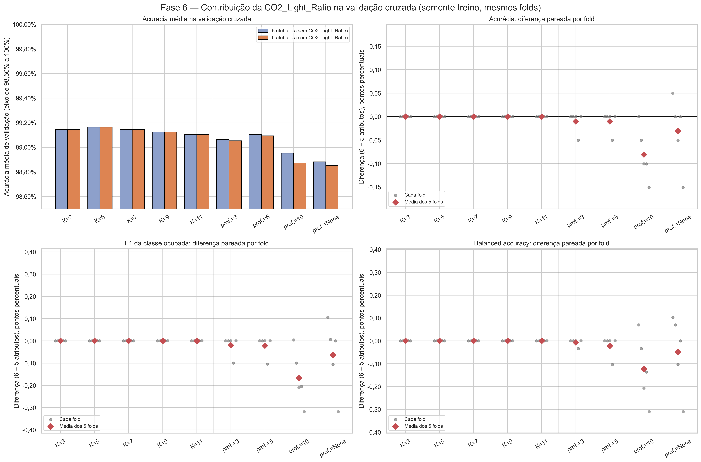
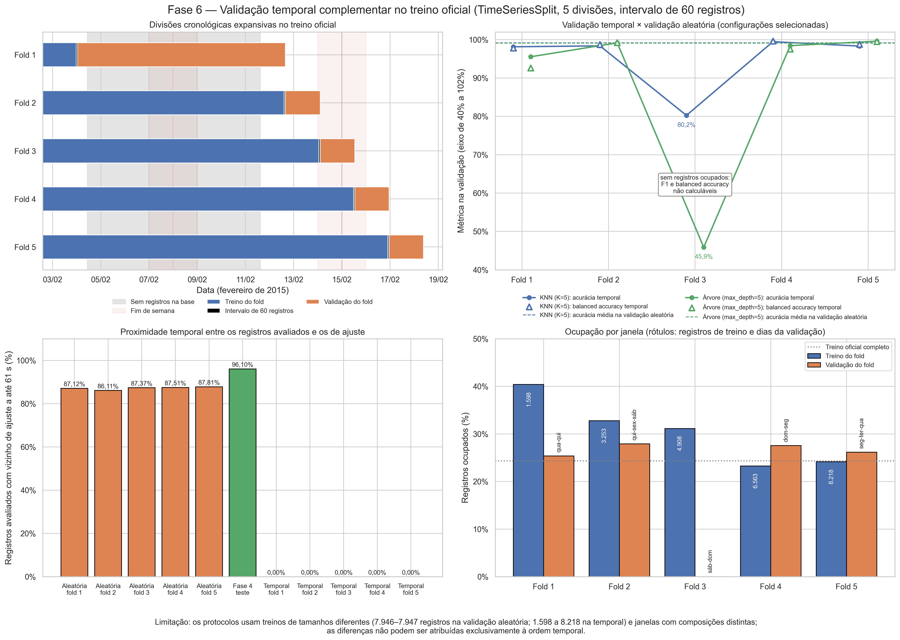

### Fase 7 — Avaliação final e veredito

| Teste oficial (2.484 registros) | DummyClassifier | KNN (K = 3) | Árvore (`max_depth` = 5) |
|---|---:|---:|---:|
| Acurácia | 75,68% | **99,56%** | 99,03% |
| Balanced accuracy | 50,00% | 99,54% | 99,14% |
| Precision / recall (ocupado) | indefinida / 0% | 98,69% / 99,50% | 96,77% / 99,34% |
| F1 (ocupado) | 0 | 99,09% | 98,04% |
| TN / FP / FN / TP | 1.880 / 0 / 604 / 0 | 1.872 / 8 / 3 / 601 | 1.860 / 20 / 4 / 600 |

| `datatraining.txt` (8.143 registros, sem ajuste) | DummyClassifier | KNN (K = 3) | Árvore (`max_depth` = 5) |
|---|---:|---:|---:|
| Acurácia | 78,77% | 95,71% | **98,13%** |
| Recall (ocupado) | 0% | 93,41% | 98,96% |
| FP / FN | 0 / 1.729 | 235 / 114 | 134 / 18 |

- A precision do baseline é indefinida (nenhuma previsão positiva). No teste, nenhum erro ocorre com `Light = 0`, e a maioria está a até 10 minutos de uma mudança de ocupação. McNemar exploratório: p = 0,0072 (registros temporalmente dependentes; resultado não confirmatório).
- **Veredito acadêmico: KNN com K = 3.** O enunciado pede a comparação das acurácias exclusivamente no teste e a indicação do modelo de desempenho superior a ser adotado. O KNN teve a maior acurácia no teste oficial (99,56% contra 99,03%), menos erros (11 contra 24), com menos falsos positivos (8 contra 20) e menos falsos negativos (3 contra 4), e também foi superior na validação cruzada (99,17% contra 99,07%) e na validação temporal (94,62% contra 87,27%). As margens são pequenas e o resultado não indica superioridade universal do KNN.
- **Consideração operacional:** a **Árvore de Decisão com `max_depth` = 5** permanece como **candidata alternativa para avaliação operacional supervisionada**, e não como opção superior. A favor dela, há o melhor resultado na avaliação complementar do `datatraining.txt` (98,13% contra 95,71%; 18 contra 114 falsos negativos), as regras auditáveis e as previsões iguais nas duas versões dos dados no teste e no `datatraining.txt` (o que não prova robustez em geral). Contra ela, há o desempenho inferior no teste, na validação cruzada e na validação temporal, sobretudo no fold 3 (896 contra 330 erros). A alta proximidade temporal entre treino e teste (96,10% a até 61 s) limita a interpretação do teste como estimativa de generalização e pode beneficiar modelos que exploram padrões locais, mas não demonstra isoladamente um efeito causal.
- **Nenhum modelo está suficientemente validado para implantação autônoma:** ambos exigem validação operacional adicional. Há risco de retroalimentação, porque `Light` é a raiz da árvore (`Light ≤ 388,15 lux`) e o próprio sistema controlaria a iluminação. Falsos positivos (desocupado classificado como ocupado) podem manter sistemas ligados sem necessidade; falsos negativos (ocupado classificado como desocupado) podem prejudicar conforto, iluminação e climatização. Essas consequências são potenciais, não medidas. Não houve medição de consumo de energia, e o projeto não estima economia, kWh, valores financeiros ou emissões.

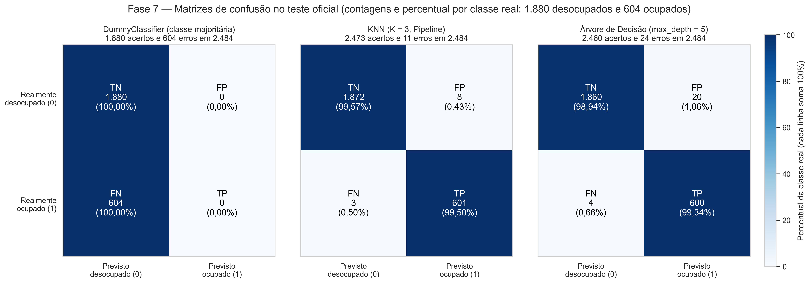
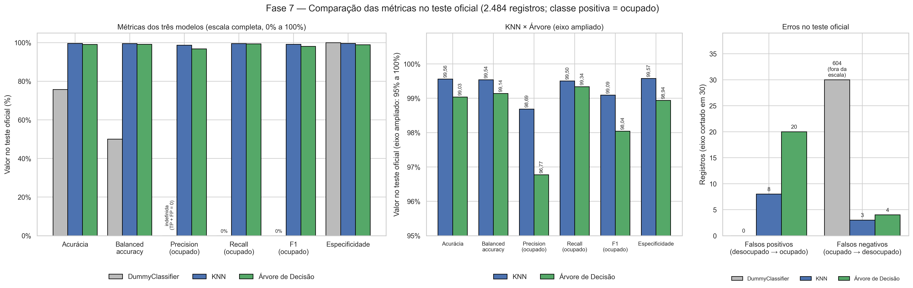
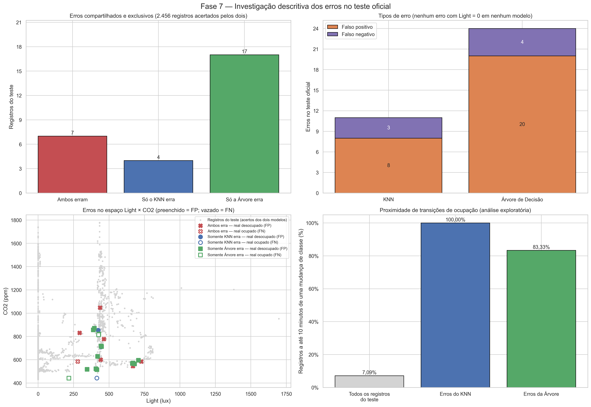
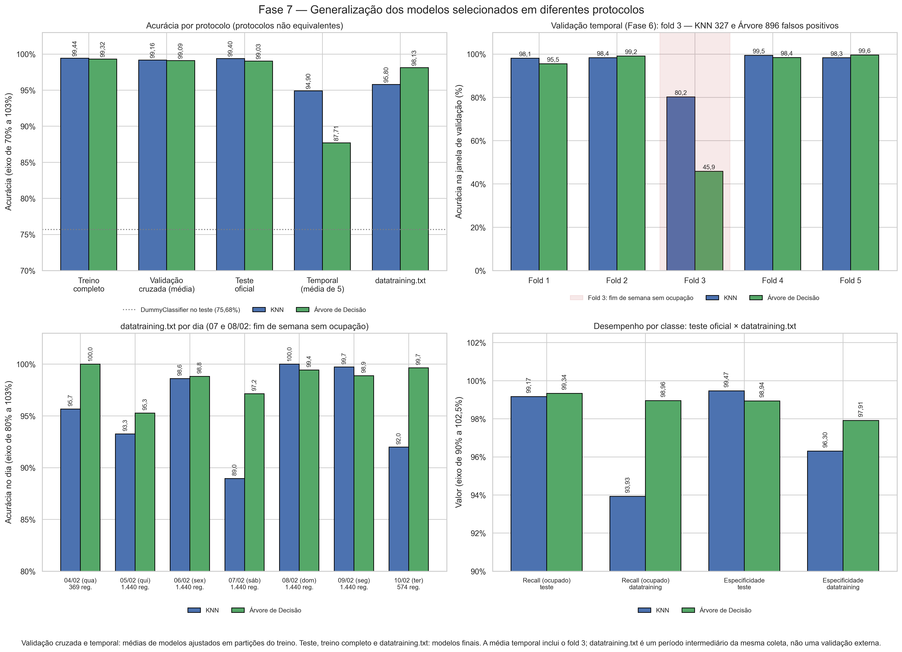

### Revisão da precisão decimal: versão anterior × versão revisada

A regra decimal foi solicitada **depois** da primeira avaliação completa. Todas as fases foram reprocessadas a partir dos dados brutos, com o mesmo split, os mesmos folds, a mesma grade e o mesmo critério de seleção. O teste oficial e o `datatraining.txt` já tinham sido consultados na versão anterior; por isso, a comparação é uma **análise de sensibilidade posterior**, e não uma avaliação independente. A regra permaneceu fixa, sem ajustes em função das métricas.

| Aspecto | Versão anterior (precisão original) | Versão revisada |
|---|---|---|
| Hiperparâmetros selecionados | K = 5; `max_depth` = 5 | K = 3; `max_depth` = 5 |
| Teste: acurácia KNN / Árvore | 99,40% / 99,03% | 99,56% / 99,03% |
| Teste: FP / FN KNN | 10 / 5 | 8 / 3 |
| `datatraining.txt`: acurácia KNN / Árvore | 95,80% / 98,13% | 95,71% / 98,13% |
| `datatraining.txt`: FN KNN / Árvore | 105 / 18 | 114 / 18 |
| Temporal: média KNN / Árvore | 94,90% / 87,71% | 94,62% / 87,27% |
| Veredito acadêmico | KNN (K = 5) superior no teste, mas Árvore indicada para adoção | **KNN com K = 3** |
| Consideração operacional | Árvore, implantação supervisionada | Árvore como candidata alternativa para avaliação supervisionada; nenhum modelo validado para operação autônoma |

Com as configurações fixas (K = 5 e `max_depth` = 5), o efeito isolado da regra foi pequeno: a Árvore teve previsões idênticas no teste e no `datatraining.txt`, e o KNN com K = 5 errou 4 registros a menos no teste e 11 a menos no `datatraining.txt`. A troca para K = 3 decorreu de uma diferença de um registro na validação cruzada e não trouxe ganho fora do teste. Os valores históricos estão preservados em [`resultados/referencia_historica/resultados_versao_precisao_integral.csv`](resultados/referencia_historica/resultados_versao_precisao_integral.csv), com a origem e o SHA-256 de cada valor; a comparação completa está em [`resultados/modelagem/comparacao_precisao_decimal.csv`](resultados/modelagem/comparacao_precisao_decimal.csv).

**Rastreabilidade da versão anterior:**

- A Fase 7 com a precisão original (script SHA-256 `1209aab0…`) está preservada no histórico Git no commit `c677cf69ac212cbf2ee2a55ba2d86f8b2532530a`, imediatamente anterior ao commit da revisão decimal.
- O arquivo `resultados/referencia_historica/resultados_versao_precisao_integral.csv` (294 linhas × 10 colunas) foi gerado uma única vez a partir da reexecução isolada daquele script, que reproduziu byte a byte os 25 artefatos derivados da versão anterior, e dos CSVs de resultados daquela versão. Cada linha identifica a versão, a seção, o protocolo, o modelo, a configuração, a métrica, o valor integral, a origem e o SHA-256 do artefato de origem.
- O arquivo é usado **somente** para auditoria e comparação (BLOCOS 43, 64 e 103 a 108): conferência dos índices do split e dos folds e cálculo das diferenças. Ele não participa do ajuste nem da seleção dos modelos revisados, e não exige acesso a backups ou caminhos absolutos.
- Para reproduzir os valores históricos, basta fazer o checkout do commit da Fase 7 original e executar o script daquela versão a partir dos dados brutos.

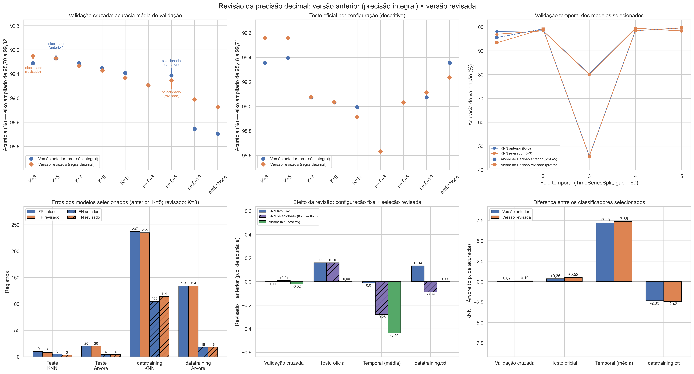

### Arquivos de resultados (`resultados/modelagem/`)

| Arquivo | Conteúdo |
|---|---|
| `cv_hiperparametros.csv`, `cv_feature_engineering.csv`, `cv_temporal.csv` | Métricas por fold da validação cruzada, da comparação 5 × 6 atributos e da validação temporal |
| `metricas_avaliacao_final.csv`, `metricas_avaliacao_complementar.csv` | Métricas no teste oficial e no `datatraining.txt` (métricas indefinidas identificadas) |
| `previsoes_teste.csv`, `previsoes_avaliacao_complementar.csv`, `analise_erros_teste.csv` | Previsões por registro e análise dos erros |
| `auditoria_precisao_decimal.csv` | Auditoria do arredondamento por atributo e comparação da base consolidada com a tratada |
| `comparacao_precisao_decimal.csv` | Comparação integral entre a versão anterior e a revisada |

## 8. Limitações metodológicas

- **Dependência temporal e split aleatório:** 96,10% dos registros de teste têm o vizinho temporal imediato no treino; o teste e a validação cruzada são otimistas para outros períodos.
- **Composição da base:** uma única sala, em fevereiro de 2015, com um único fim de semana na base consolidada; o `datatraining.txt` é da mesma coleta e não é uma validação externa.
- **Análises na base completa:** a EDA, os outliers e a escolha da variável derivada observaram a base inteira antes da divisão.
- **Consultas ao teste:** o teste foi consultado na Fase 6 por exigência do enunciado e já havia sido avaliado antes da revisão decimal.
- **Precisão decimal:** a regra é uma convenção do projeto, com perda potencial de informação; a resolução física dos sensores não é conhecida. O efeito observado foi pequeno, mas não se generaliza automaticamente.
- **Seleção instável:** as diferenças entre configurações são da ordem de um registro por fold (a revisão trocou K = 5 por K = 3).
- **Desbalanceamento:** 24,33% de ocupados; por isso foram usadas métricas por classe.
- **`Light` em automação predial:** forte dependência de um único sensor, sensível à luz natural e sujeito a retroalimentação.
- **Variável derivada:** constante `+1` arbitrária, sem significado físico validado e sem ganho preditivo demonstrado.
- **Escalonamento:** o `StandardScaler` é sensível a valores extremos e não altera correlações nem a forma das distribuições.

## 9. Próximas etapas

- Revisão final da documentação.
- Gerar e versionar o notebook único executado.
- Merge final na `main` e gravação do vídeo de apresentação.

Melhorias futuras fora do escopo: validação em outros ambientes, estações e períodos futuros, sensores adicionais, documentação da resolução dos sensores, medição de energia e monitoramento do modelo em produção.

## 10. Versionamento

Fluxo: `main` ← `develop` ← branches `feature/*`, com pull requests para `develop` e branches preservadas após o merge.

| Branch | Objetivo | Situação |
|---|---|---|
| `feature/00-base-dados` | Aquisição e preservação dos dados originais | PR #1 mesclado |
| `feature/01-eda` | ETL e Fase 1 | PR #2 mesclado |
| `feature/02-data-prep` | Fase 2 | PR #3 mesclado |
| `feature/03-feature-engineering` | Fase 3 | PR #4 mesclado |
| `feature/09-revisao-geral` | Correções da auditoria geral das Fases 1 a 3 | PR #5 mesclado |
| `feature/08-documentacao` | README e requirements | PRs #6 e #9 mesclados; será atualizada ao final |
| `feature/04-train-test-split` | Fase 4 | PR #7 mesclado |
| `feature/05-standard-scaler` | Fase 5 | PR #8 mesclado |
| `feature/06-hiperparametros` | Fase 6 | PR #10 mesclado |
| `feature/07-avaliacao-modelos` | Fase 7 (commit da versão original), revisão da precisão decimal e documentação | Pull request para a `develop` |

## 11. Referências

- Candanedo, L. (2016). *Occupancy Detection* [Dataset]. UCI Machine Learning Repository. <https://doi.org/10.24432/C5X01N>
- Candanedo, L.; Feldheim, V. (2016). Accurate occupancy detection of an office room from light, temperature, humidity and CO2 measurements using statistical learning models. *Energy and Buildings*, 112.
- Documento oficial do Projeto Avaliativo e materiais didáticos MUS01 e MUS02 do curso (uso local, não redistribuídos).
- [scikit-learn — documentação](https://scikit-learn.org/stable/); repositórios didáticos [mapa-hard-skills](https://github.com/Desenvolvimento-IA-Analise-Preditiva-T1/mapa-hard-skills) e [scikit-learn-pipeline](https://github.com/Desenvolvimento-IA-Analise-Preditiva-T1/scikit-learn-pipeline).
