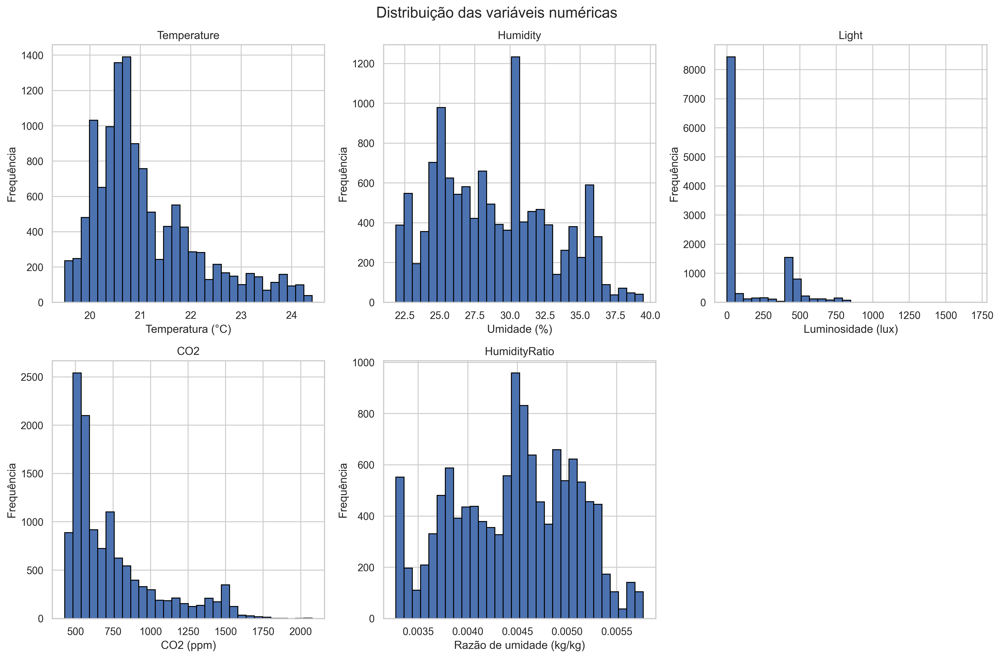

# Ocupação Inteligente — Indústria 4.0

Pipeline de Ciência de Dados e Machine Learning para identificar a ocupação de ambientes a partir de sensores ambientais IoT, aplicado à automação predial e à eficiência energética.

> **Status:** em desenvolvimento. As Fases 1 a 3 (EDA, Data Prep e Feature Engineering) estão concluídas, revisadas por uma auditoria geral (PR #5) e publicadas na branch `develop`. As Fases 4 a 7 (divisão dos dados, escalonamento, ajuste de hiperparâmetros e avaliação final) ainda não foram implementadas; não existem modelos treinados nem métricas de desempenho. Esta documentação será complementada com os resultados finais.

| Item | Informação |
|---|---|
| Autor | Petras Ruben Carvalho |
| Curso | SCTEC Aperfeiçoar — Integração de IA com Dados (SENAI/SC) |
| Professor | Felipe Rodrigues Souza |
| Entrega | AVA, até 30/11/2026 às 22h |

## 1. Problema e objetivo

Um complexo industrial equipado com sensores ambientais precisa saber se salas técnicas e escritórios estão ocupados, para automatizar o desligamento de iluminação e climatização (HVAC). O projeto treinará e comparará dois classificadores supervisionados — **KNN (K-Nearest Neighbors)** e **Árvore de Decisão** — para prever a variável binária `Occupancy` (0 = desocupado, 1 = ocupado), usando a acurácia como métrica principal.

O trabalho é experimental: não inclui integração com equipamentos reais nem estimativa de economia de energia.

## 2. Base de dados

**Occupancy Detection** — Luis Candanedo (2016), UCI Machine Learning Repository. DOI [10.24432/C5X01N](https://doi.org/10.24432/C5X01N). Licença [CC BY 4.0](https://creativecommons.org/licenses/by/4.0/). Página oficial: [archive.ics.uci.edu/dataset/357](https://archive.ics.uci.edu/dataset/357/occupancy-detection).

| Coluna | Descrição | Unidade |
|---|---|---|
| `date` | Data e hora da observação | `AAAA-MM-DD hh:mm:ss` |
| `Temperature` | Temperatura do ambiente | °C |
| `Humidity` | Umidade relativa do ar | % |
| `Light` | Luminosidade | lux |
| `CO2` | Concentração de dióxido de carbono | ppm |
| `HumidityRatio` | Razão de umidade, derivada da temperatura e da umidade relativa | kg de vapor / kg de ar |
| `Occupancy` | Variável alvo | 0 = desocupado, 1 = ocupado |

### Composição da base

| Arquivo | Registros | Período (2015) | Ocupados | Uso |
|---|---:|---|---:|---|
| `datatest.txt` | 2.665 | 02/02 14:19 a 04/02 10:43 | 36,47% | Consolidado |
| `datatraining.txt` | 8.143 | 04/02 17:51 a 10/02 09:33 | 21,23% | Preservado, fora da consolidação |
| `datatest2.txt` | 9.752 | 11/02 14:48 a 18/02 09:19 | 21,01% | Consolidado |
| **Base utilizada** | **12.417** | dois segmentos contínuos | **24,33%** | Todas as fases |

A consolidação dos dois arquivos `datatest` é uma escolha metodológica deste projeto, distinta do protocolo original de avaliação do conjunto de dados (a UCI descreve os arquivos apenas como conjuntos "for training and testing"). O exemplo do enunciado lê somente `datatest.txt`. O arquivo `datatraining.txt` é preservado sem alterações e não participa das análises. Atribuição, hashes SHA-256 e rastreabilidade das bases derivadas: [dados/README.md](dados/README.md).

## 3. Tecnologias

| Tecnologia | Versão testada | Uso |
|---|---|---|
| Python | 3.14.4 | Linguagem |
| pandas | 3.0.2 | Manipulação de dados |
| NumPy | 2.4.4 | Operações numéricas |
| Matplotlib | 3.10.9 | Gráficos |
| Seaborn | 0.13.2 | Gráficos estatísticos |
| scikit-learn | 1.8.0 | Modelagem e avaliação |
| SciPy | 1.18.1 | Dependência do scikit-learn e da correlação de Spearman no pandas |
| ipykernel | 7.2.0 | Execução do notebook |

Ferramentas: VS Code com células `# %%`, Jupyter, Git e GitHub.

As versões acima estão fixadas no [`requirements.txt`](requirements.txt). O projeto foi testado apenas em **Python 3.14.4 no Windows**. Os metadados das dependências selecionadas exigem Python 3.12 ou superior (`scipy==1.18.1`); não há garantia de compatibilidade com versões não testadas.

O `requirements.txt` contém somente as dependências de execução do projeto. As ferramentas usadas para converter o script em notebook (`jupytext` e `nbconvert`) são instaladas à parte, apenas no momento da exportação.

## 4. Estrutura do repositório

```text
ocupacao_inteligente_industria_4_0/
├── dados/
│   ├── brutos/            # pacote original da UCI e os três arquivos .txt (sem alterações)
│   ├── consolidados/      # occupancy.csv — 12.417 × 7
│   ├── tratados/          # occupancy_tratado.csv — 12.417 × 7 (Fase 2)
│   ├── features/          # occupancy_features.csv — 12.417 × 8 (Fase 3)
│   └── README.md          # origem, licença, hashes e rastreabilidade
├── resultados/
│   └── graficos/          # gráficos exportados em 300 DPI
├── ocupacao_inteligente.py  # desenvolvimento em células # %% (fonte do notebook)
├── requirements.txt
├── README.md
├── .gitignore
└── .gitattributes
```

O notebook único de entrega (`ocupacao_inteligente.ipynb`) ainda não está no repositório: será gerado a partir do script e executado ao final das sete fases.

## 5. Como executar

Nesta versão, o código está na branch `develop`; a `main` contém apenas a estrutura inicial e receberá o projeto completo ao final.

```powershell
git clone https://github.com/petrascarvalho/ocupacao_inteligente_industria_4_0.git
cd ocupacao_inteligente_industria_4_0
git switch develop
py -3.14 -m venv .venv
.\.venv\Scripts\python.exe -m pip install -r requirements.txt
```

No VS Code, selecione o interpretador `.venv` e execute as células do arquivo [`ocupacao_inteligente.py`](ocupacao_inteligente.py) em ordem. Também é possível executar o script inteiro pelo terminal, a partir da raiz do repositório:

```powershell
.\.venv\Scripts\python.exe ocupacao_inteligente.py
```

Na execução pelo terminal, cada gráfico abre em uma janela, e a execução continua depois que a janela é fechada.

Todos os caminhos são relativos à raiz do repositório. Se os arquivos de `dados/brutos/` não existirem, o BLOCO 04 baixa o pacote oficial da UCI e extrai os arquivos necessários. A execução regrava as bases de `dados/` e os gráficos de `resultados/graficos/` com conteúdo idêntico ao publicado.

Estas instruções foram testadas em um ambiente virtual novo criado a partir do `requirements.txt` (`pip check` sem conflitos), com execução integral do script até a Fase 3 sem erros ou avisos e reprodução idêntica (mesmo SHA-256) das bases e gráficos. Serão revalidadas após a conclusão das Fases 4 a 7, quando estas instruções passarão a indicar a `main` e o notebook final.

## 6. Organização em sete fases

| Etapa | Conteúdo | Situação |
|---|---|---|
| Preparação e ETL (Blocos 00–09) | Ambiente, caminhos, download condicional, leitura, inventário dos arquivos originais, consolidação e validação | Concluída |
| Fase 1 — EDA (Blocos 10–17) | Estrutura, tipos, estatísticas, histogramas, classes, correlação, análise e dependência temporal | Concluída |
| Fase 2 — Data Prep (Blocos 18–28) | Duplicidades, ausentes, imputação simulada, tipos, precisão, boxplots, IQR | Concluída |
| Fase 3 — Feature Engineering (Blocos 29–36) | Criação e validação de `CO2_Light_Ratio` | Concluída |
| Fase 4 — Divisão dos dados | X e y; treino 80% e teste 20% com `stratify=y` e `random_state=42` | Pendente |
| Fase 5 — Escalonamento | `StandardScaler` ajustado só no treino, apenas para o KNN | Pendente |
| Fase 6 — Hiperparâmetros | K ímpares no KNN e `max_depth` na Árvore; acurácia de treino e teste | Pendente |
| Fase 7 — Avaliação final | Acurácia no teste, comparação e escolha do modelo | Pendente |

## 7. Resultados das fases concluídas

### Fase 1 — Análise exploratória

- 12.417 registros, 7 colunas, nenhum valor ausente; `date` em texto, sensores em `float64`, `Occupancy` em `int64`.
- Classes: 9.396 desocupados (75,67%) e 3.021 ocupados (24,33%). A acurácia de um classificador que sempre prevê "desocupado" seria 75,67%.
- Correlação de Pearson com `Occupancy`: `Light` 0,9197; `Temperature` 0,5764; `CO2` 0,3710; `HumidityRatio` 0,2420; `Humidity` −0,0427. Entre preditores: `Humidity` × `HumidityRatio` 0,8919 e `Temperature` × `Light` 0,7248.
- `Light` tem mediana zero (61,30% das leituras são zero); `CO2` é assimétrica à direita.
- Dependência temporal (valores medidos): observações a cada 59–61 segundos, em dois segmentos contínuos (2.665 e 9.752 registros) separados por 7 dias, 4 horas e 5 minutos. A autocorrelação de lag 1 dos sensores varia de 0,9952 a 0,9995 dentro dos segmentos. Entre as 12.415 transições válidas de um registro para o seguinte, há 74 mudanças de classe, ou seja, a classe se mantém em 99,40% delas.
- Estimativa teórica, não medida: em uma divisão aleatória de 80/20, cerca de 96% dos registros de teste teriam algum vizinho temporal imediato no treino (1 − 0,2², supondo dois vizinhos independentes). O valor real será medido após a divisão da Fase 4.




### Fase 2 — Limpeza e tratamento

- 0 duplicatas integrais e 0 timestamps repetidos. 571 repetições apenas das medições dos sensores, em instantes diferentes (1.032 registros, 1.028 deles desocupados), sem conflito de classe — mantidas.
- 0 ausentes e 0 infinitos na base real. Imputação demonstrada em cópia isolada com 50 ausentes simulados por variável (semente 42): média para `Humidity` (média 28,92 e mediana 28,60) e mediana para `CO2` (média 745,64 e mediana 632,00, com cauda à direita).
- Boxplots e IQR: 461 potenciais outliers em `Temperature`, 7 em `Light` e 992 em `CO2`. Nenhum viola os critérios de plausibilidade física aplicados; todos foram mantidos.
- Nenhum registro removido, nenhum valor arredondado; `date` convertida para `datetime` apenas em memória.
- Base tratada (`dados/tratados/occupancy_tratado.csv`): 12.417 × 7, com 9.396 desocupados e 3.021 ocupados; recarga idêntica à base em memória (`check_exact=True`).


### Fase 3 — Feature Engineering

Nova variável sugerida no enunciado: **`CO2_Light_Ratio = CO2 / (Light + 1)`**, calculada registro a registro, sem usar `Occupancy`.

- Verificações antes do cálculo: sem ausentes, infinitos ou luminosidade negativa; menor denominador igual a 1.
- Resultado: `float64`, 0 ausentes, 0 infinitos, 6.989 valores distintos; mediana 503,0, mínimo 0,56 e máximo 2.076,5.
- Com `Light = 0` (7.612 registros), o índice é exatamente igual a `CO2`; com `Light > 0` (4.805 registros), fica entre 0,56 e 263,29.
- Correlação com as variáveis de origem (sem o alvo): `CO2` — Pearson 0,2419 e Spearman 0,0686; `Light` — Pearson −0,6607 e Spearman −0,8633. Há redundância parcial com os sensores originais; o ganho preditivo ainda não foi avaliado.
- Base de Feature Engineering (`dados/features/occupancy_features.csv`): 12.417 × 8. As sete colunas originais e `Occupancy` são idênticas às da base tratada, e a nova coluna coincide exatamente com o recálculo da fórmula.
- Precisão: com o conversor padrão do `read_csv`, 850 valores da nova coluna diferem no último bit; a leitura com `float_precision="round_trip"` reconstrói todos os valores exatamente, e a recarga é validada com `check_exact=True`.


### Revisão metodológica (PR #5)

Uma auditoria geral das Fases 1 a 3, realizada antes da Fase 4, acrescentou ao script: o inventário temporal dos três arquivos originais (BLOCO 06.1), a medição da dependência temporal (BLOCO 16.2), a comparação entre média e mediana na justificativa da imputação, a fundamentação da preservação dos outliers pela plausibilidade física, a caracterização das medições repetidas e a reorganização das células Markdown. Nenhum dado, gráfico ou resultado anterior foi alterado: os 12 arquivos de dados e gráficos mantiveram os mesmos SHA-256.

## 8. Limitações metodológicas

- **Dependência temporal e split aleatório:** registros vizinhos são quase idênticos (autocorrelação de lag 1 acima de 0,99 e 99,40% de permanência da classe). A divisão aleatória exigida no enunciado tende a colocar vizinhos temporais em treino e teste, o que pode produzir estimativas otimistas de desempenho. Ela será mantida, e o efeito será medido e complementado por uma avaliação temporal.
- **Composição da base:** os dois arquivos `datatest` foram consolidados por escolha do projeto; a base tem uma descontinuidade de sete dias e proporções de ocupação diferentes entre os segmentos.
- **Análises na base completa:** a EDA, a investigação de outliers e a escolha da variável derivada foram feitas antes da divisão treino/teste. Nenhum parâmetro foi ajustado com esses dados, mas as decisões foram tomadas observando a base inteira.
- **Desbalanceamento:** a estratificação preserva a proporção das classes, mas não as balanceia. Serão apresentadas métricas complementares à acurácia.
- **`Light` em automação predial:** a luminosidade depende das próprias luzes do ambiente; um sistema que desligue a iluminação com base nela pode criar um ciclo de realimentação. Esse ponto será discutido na avaliação final.
- **Variável derivada:** a constante `+1` é arbitrária e o índice não tem significado físico validado.

## 9. Próximas etapas

- Fases 4 a 7 conforme o enunciado, com divisão 80/20 estratificada, `StandardScaler` apenas no treino e comparação de pelo menos três valores de K e três valores de `max_depth`.
- Complementos previstos: medição da proximidade temporal entre treino e teste, validação cruzada dentro do treino, `Pipeline` sem escalonamento duplicado, comparação com e sem `CO2_Light_Ratio` (somente no treino), baseline da classe majoritária, matriz de confusão, precision, recall, F1-score, balanced accuracy e uma avaliação temporal complementar.
- Notebook único executado, atualização deste README com os resultados e merge final na `main`.

Melhorias futuras fora do escopo: validação em outros ambientes e períodos, monitoramento do modelo em produção e integração com sistemas prediais.

## 10. Versionamento

Fluxo: `main` ← `develop` ← branches `feature/*`, com pull requests para `develop` e branches preservadas após o merge.

| Branch | Objetivo | Situação |
|---|---|---|
| `feature/00-base-dados` | Aquisição e preservação dos dados originais | PR #1 mesclado |
| `feature/01-eda` | ETL e Fase 1 | PR #2 mesclado |
| `feature/02-data-prep` | Fase 2 | PR #3 mesclado |
| `feature/03-feature-engineering` | Fase 3 | PR #4 mesclado |
| `feature/09-revisao-geral` | Correções da auditoria geral das Fases 1 a 3 | PR #5 mesclado |
| `feature/08-documentacao` | README e requirements | Publicação inicial; será atualizada ao final |
| `feature/04-train-test-split` | Fase 4 | Criada, implementação pendente |
| `feature/05-standard-scaler` a `feature/07-avaliacao-modelos` | Fases 5 a 7 | Planejadas |

## 11. Referências

- Candanedo, L. (2016). *Occupancy Detection* [Dataset]. UCI Machine Learning Repository. <https://doi.org/10.24432/C5X01N>
- Candanedo, L.; Feldheim, V. (2016). Accurate occupancy detection of an office room from light, temperature, humidity and CO2 measurements using statistical learning models. *Energy and Buildings*, 112.
- Documento oficial do Projeto Avaliativo e materiais didáticos MUS01 e MUS02 do curso (uso local, não redistribuídos).
- [scikit-learn — documentação](https://scikit-learn.org/stable/); repositórios didáticos [mapa-hard-skills](https://github.com/Desenvolvimento-IA-Analise-Preditiva-T1/mapa-hard-skills) e [scikit-learn-pipeline](https://github.com/Desenvolvimento-IA-Analise-Preditiva-T1/scikit-learn-pipeline).

## 12. Ferramentas de apoio ao desenvolvimento

O item 8 do enunciado original vedava o uso de IA para gerar ou escrever o código do projeto. Uma atualização posterior do documento, sem data identificada, autorizou o uso de ferramentas de Inteligência Artificial (como ChatGPT, Claude, GitHub Copilot e outras) no projeto avaliativo. Houve assistência direta de IA, incluindo a escrita de código e de textos interpretativos, em fases anteriores à consulta dessa atualização pelo estudante. A declaração abaixo descreve as contribuições efetivas, sem atribuir ao estudante autoria exclusiva do que foi produzido com apoio das ferramentas.

| Ferramenta | Contribuições |
|---|---|
| ChatGPT (OpenAI) | Planejamento do projeto e roteiro das fases; elaboração e revisão dos prompts de cada etapa; revisão e proposta de código do ETL; propostas de visualização; código da verificação de unicidade temporal (BLOCO 16.1); textos interpretativos da EDA; revisões metodológicas; planejamento das auditorias; documentação de continuidade do projeto |
| Claude Code (Anthropic) | Preparação do ambiente e da estrutura de pastas; aquisição dos dados e conferência de hashes; implementação e revisão de código; implementação dos gráficos e complementos interpretativos da EDA; implementação e interpretação do Data Prep (Blocos 18–28) e da Feature Engineering (Blocos 29–36); auditoria geral e correções da revisão (PR #5); backups, execuções isoladas e testes de reprodutibilidade; teste do procedimento de exportação do notebook; preparação deste README e do `requirements.txt`; commits, pull requests e merges executados com autorização do estudante |
| Estudante | Definição do escopo e das prioridades; escolha da composição da base e da variável derivada; decisão de preservar todos os registros; supervisão das etapas, revisão dos resultados apresentados e autorização de cada etapa, incluindo os versionamentos; responsável pela gravação do vídeo de apresentação (pendente), que não utilizará ferramentas de criação de vídeo com IA |

A aceitação acadêmica do trabalho depende da avaliação do professor.
